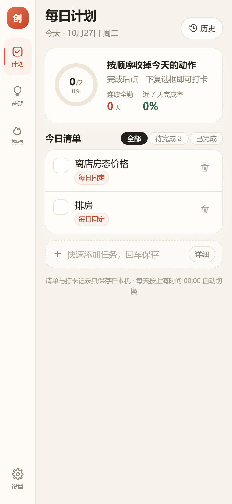
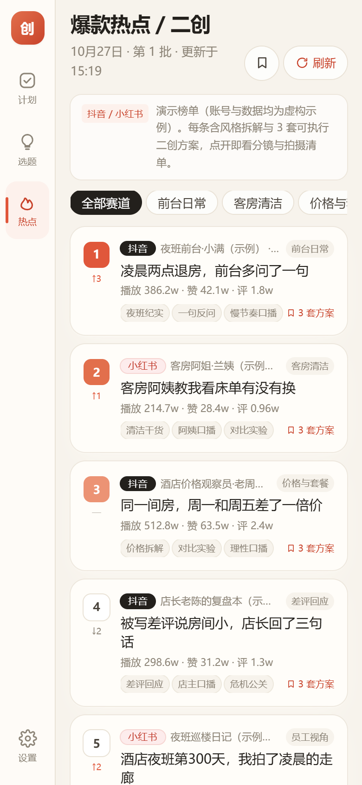
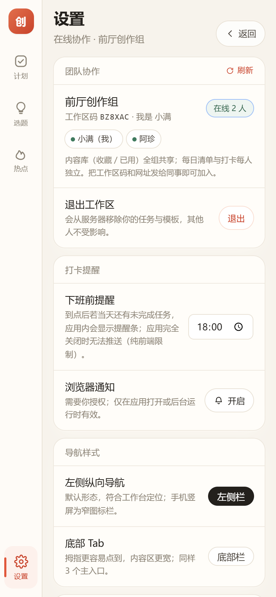

# 酒店自媒体创作工作台

手机端优先的**自媒体创作工作台**：每日计划打卡 → 当日酒店类选题灵感 → 爆款热点与二创方案，三段闭环。

纯前端 PWA，可「添加到主屏幕」当 App 用；默认数据只存本机 IndexedDB。可选的**团队协作模式**支持 10 人左右共享内容库、各自打卡——凭「工作区码 + 昵称」加入，**没有密码、没有注册表单**。

<p>
  
  
  
  
</p>

## 三个页面

### 1. 每日计划 `/plan`

- 默认预置 **离店房态价格**、**排房** 两条固定任务，按天自动生成清单
- 点一下就打卡，进度环 + 连续全勤 + 近 7 天完成率
- 自由增删任务、可设为「每日固定」、删除 5 秒内可撤销
- 历史月历：每天完成率一目了然，点开看当天只读清单

### 2. 选题灵感 `/inspiration`

- 抖音 / 小红书双平台酒店类爆款，按平台筛选、按热度或批次排序
- **逐条**拆解火爆原因：选题缺口 / 文案钩子 / 关键词与话题 / 形式与节奏
- 每条给出 ≥2 个原创创作思路：备选标题、内容结构、酒店场景切入点、拍摄清单、发布建议
- 关键词、话题一键复制；可跳转平台搜索该内容；收藏 / 已用沉淀到内容库

### 3. 爆款热点 / 二创 `/hotspot`

- Top 10 热榜，含排名变化与 NEW 标识，按赛道筛选
- 账号风格拆解五项：人设定位 / 开头 3 秒 / 叙事结构 / 视听元素 / 评论区钩子
- 每条 **3 套**改编维度不同的二创方案：同结构换场景、换主角视角、换冲突或结论
- 每套含 6 格分镜、口播要点、拍摄清单、BGM/封面建议、发布建议、去重与合规提醒
- 整套方案可复制为 Markdown，直接发给剪辑

辅助页面：`/plan/history` 历史统计、`/library` 内容库、`/settings` 设置（团队协作、提醒、导航样式、导出/导入、清空数据、免责声明）。

## 团队协作（可选，10 人内）

默认是**本地模式**：数据只存自己设备，不需要后端。

想要 10 个同事一起用，打开「设置 → 团队协作」：

1. 填协作服务地址（后端部署一次即可，见 [docs/06-后端部署.md](docs/06-后端部署.md)，免费额度足够）；
2. 点「新建工作区」→ 得到 6 位工作区码；
3. 把「网址 + 服务地址 + 工作区码」发给同事，他们填昵称加入。

| 数据 | 归属 |
|---|---|
| 每日清单、打卡、每日固定模板 | **每人独立**，互不干扰 |
| 选题灵感 / 热点批次的刷新 | 工作区共享同一批（谁刷新，大家看到同一批） |
| 收藏 / 已用内容库 | **工作区共享**，换人换设备都在 |
| 提醒时间、导航样式 | 每人独立 |

加入后设置页显示工作区成员与「在线 N 人」（30 秒心跳）；没有密码，退出会移除自己在服务端的任务。安全边界（token 摘要存储、频率限制、越权 404）见 [后端 API 契约](docs/05-后端API契约.md)。

## 数据说明（重要）

首版为**演示数据**：内置 12 条选题、10 条热点，文案自写、账号与数据均为虚构示例。

- 点「刷新」会换一批示例（批次语义：同日期同时段内容稳定，刷新递增批次）。
- 「查看原内容 / 原爆款入口」跳转的是**该关键词的平台搜索结果页**，不是原视频地址，界面已标注「演示链接」。
- 真实数据接入位已按 `ContentSource` 接口预留（`src/lib/source/`），替换实现后 UI 零改动。
- **本项目不包含任何平台抓取代码**，原因与合规边界见 [docs/02-数据源与合规调研.md](docs/02-数据源与合规调研.md)。

## 快速开始

```bash
npm install
npm run dev        # 本地开发 http://localhost:5173
npm run build      # 类型检查 + 生产构建（dist/）
npm run preview    # 预览构建产物
npm test           # 单元测试（统计口径、时区、数据质量、链接白名单）
npm run check:data # 只跑演示数据质量闸门

# 团队协作后端（本地开发 / 自托管）
node server/dev.mjs         # http://127.0.0.1:8787
node scripts/api-test.mjs   # 后端集成测试（10 成员并发、越权、限流）
```

开发期自检（可选，需要本机有 Chrome）：

```bash
npm run preview          # 先起预览服务（127.0.0.1:4173）
node scripts/e2e-check.mjs  # 端到端交互检查：打卡/增删撤销/刷新/收藏/提醒/导航
node scripts/shots.mjs      # 生成手机与桌面截图
```

## 部署到 GitHub Pages

1. 新建仓库并推送本目录（`main` 分支）。
2. 仓库 Settings → Pages → Source 选 **GitHub Actions**。
3. `.github/workflows/deploy.yml` 会在 push 后自动构建并发布。
4. 构建使用相对路径 `base: './'`，项目页 `/repo-name/` 与自定义域名都能直接跑；`404.html` 会把任意深链带回入口。

> 国内访问 GitHub Pages 可能较慢，纯静态产物也可直接部署到 Vercel / Netlify / 任意静态托管。

## 技术栈

React 18 + TypeScript + Vite 6 + Tailwind CSS + Zustand + IndexedDB(idb) + vite-plugin-pwa + Vitest。

可选协作后端：Cloudflare Worker + D1（免费额度足够 10 人），本地开发用同构 Node 适配器（零第三方依赖）。

- 时区统一 `Asia/Shanghai`，不随设备时区漂移；时钟可注入，便于测试「时间旅行」。
- Hash 路由，静态托管刷新不 404。
- 演示数据质量闸门：`src/data/data.test.ts` 校验每条归因/方案字段完整、长度达标、引用自身关键词，防止模板套话。
- 协作后端：前端只认 `ContentSource`/`data` 门面，本地模式与在线模式同一套 UI。

## 目录结构

```
src/
  components/   布局、抽屉、卡片、图标、Toast、引导
  pages/        计划 / 历史 / 选题 / 热点 / 内容库 / 设置
  store/        zustand：tasks、content、settings、session
  lib/          clock(时区) stats(统计口径) data(本地/在线门面) repo(IndexedDB)
                api(协作客户端) source(数据源适配器) markdown(导出)
  data/         topics.json / hotspots.json + 数据质量测试
  types.ts      领域类型
server/         API 核心 handler + JSON 存储 + 本地 dev server + schema.sql
worker/         Cloudflare Worker 入口 + D1 存储适配器
docs/           需求、调研、审计、修复记录、API 契约、部署、截图
scripts/        api-test / e2e-check / e2e-online / shots
```

## 提醒的能力边界

「下班前未打卡提醒」在**应用打开或后台运行时**生效：应用内提醒条 + 可选浏览器通知。纯前端无法在应用完全关闭后定时推送；需要真后台推送时应加服务端或 Web Push 服务（见路线图）。

## 文档

- [01-需求分析](docs/01-需求分析.md)：范围、功能规格、验收标准、数据模型、里程碑、多人协作章节
- [02-数据源与合规调研](docs/02-数据源与合规调研.md)：官方接口、第三方服务、合规风险与路线结论
- [03-代码审计](docs/03-代码审计.md)：独立审计问题清单（P0/P1/P2）与测试盲区
- [04-修复记录](docs/04-修复记录.md)：审计问题修复状态、新增回归测试、剩余风险
- [05-后端API契约](docs/05-后端API契约.md)：协作接口、表结构、鉴权、限流
- [06-后端部署](docs/06-后端部署.md)：10 分钟部署 Cloudflare Worker + D1（面向非程序员）

## 路线图

- [x] M1 工程骨架（PWA、导航、移动端适配）
- [x] M2 每日计划（打卡、进度、跨天、历史统计）
- [x] M3 选题灵感（列表、归因、原创思路、刷新）
- [x] M4 爆款热点 / 二创（榜单、拆解、3 套方案、复制导出）
- [x] M5 内容库、设置、导出导入、提醒
- [ ] V2 真实数据源：粘贴链接半自动解析
- [ ] V2 内容日历 / 发布排期
- [ ] V2 发布后数据回流看板

## 许可

代码 MIT，见 [LICENSE](LICENSE)；免责声明见 [DISCLAIMER.md](DISCLAIMER.md)。

本项目为个人工具，与抖音、小红书等平台无任何关联，不含平台真实数据与商标素材。
